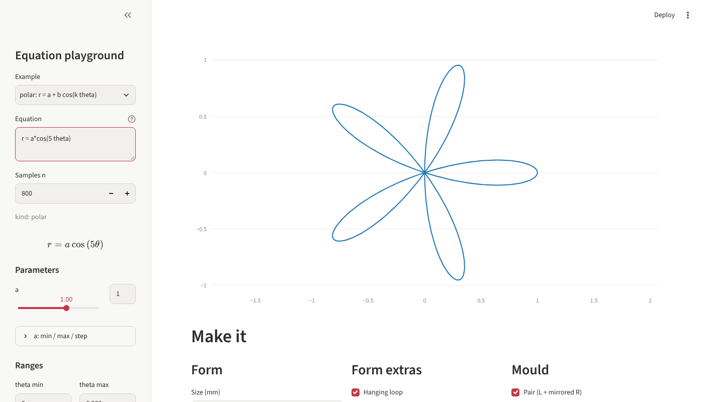
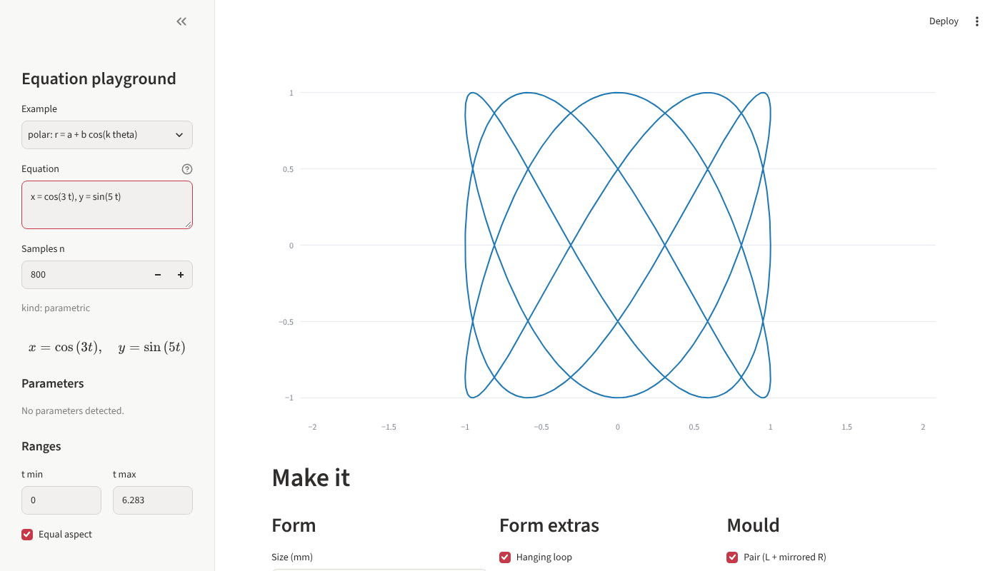
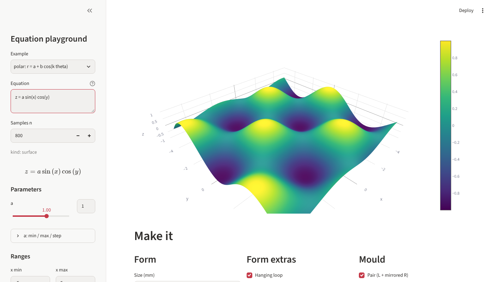
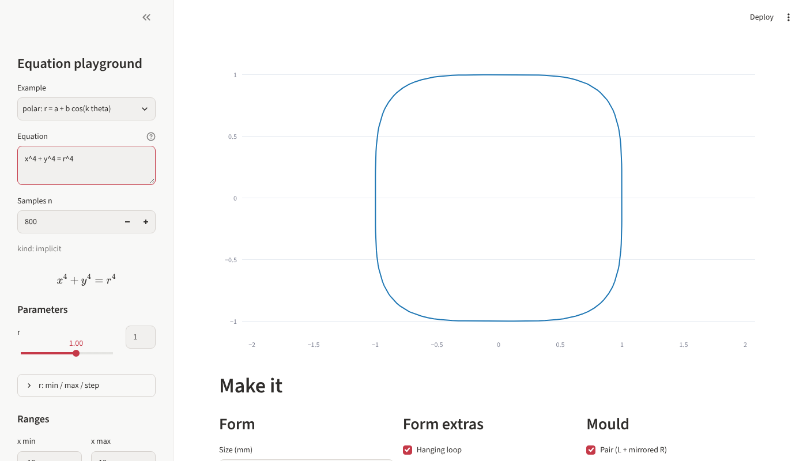
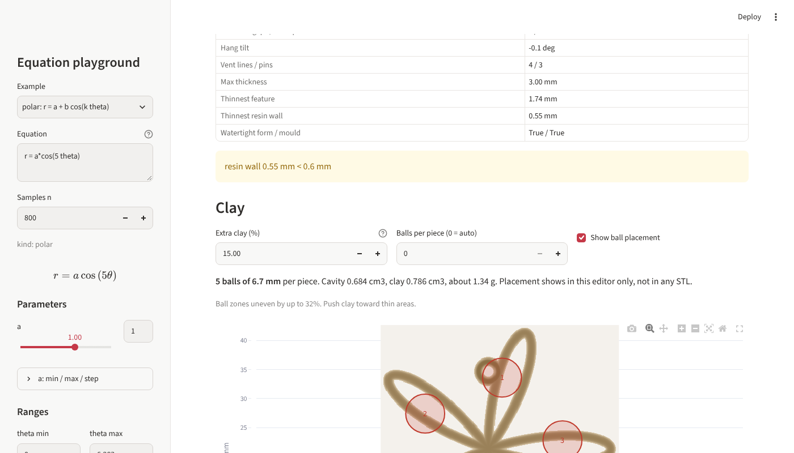

# press-moulds

Mathematical jewellery moulds. Type an equation, tune sliders, export SVG and STL for a resin press mould.

The app lives in [`equation-playground/`](equation-playground/). Full feature notes: [`equation-playground/README.md`](equation-playground/README.md).

## Screenshots

| Polar rose `r = a*cos(5 theta)` | Lissajous `x = cos(3 t), y = sin(5 t)` |
|---|---|
|  |  |

| Surface `z = a sin(x) cos(y)` | Implicit `x^4 + y^4 = r^4` |
|---|---|
|  |  |

Check report (thin walls, watertight) and clay ball placement after a build:



## Install

You need Python 3.10 or newer.

```
git clone https://github.com/joshfryart/press-moulds.git
cd press-moulds/equation-playground
python -m pip install -r requirements.txt
```

On Windows, use `python -m pip` (not bare `pip`) to avoid broken-launcher errors. If `python` is not found, use `py` instead.

## Run

From inside `equation-playground/`:

```
python -m streamlit run app.py
```

Your browser opens at http://localhost:8501.

## Use

1. Pick an example, or type an equation in the **Equation** box (press Ctrl+Enter to apply).
2. Tune the sliders that appear for each symbol.
3. Under **Make it**, set size, strand, loop, mould options. Press **Draft build** for a fast look, then **Build** for print quality.
4. Read the **Check** table. Fix any warnings.
5. Download SVG, STL files, or one zip with everything.

### Equations to try

| Kind | Equation |
|---|---|
| explicit | `y = a sin(b x) + 0.3 x` |
| implicit | `x^2 + y^2 = r^2` |
| implicit | `x^4 + y^4 = r^4` |
| parametric | `x = a cos(t), y = b sin(k t)` |
| parametric | `x = cos(t) + 0.5 cos(7 t), y = sin(t) + 0.5 sin(7 t)` |
| polar | `r = a + b cos(k theta)` |
| surface | `z = a sin(x) cos(y)` |

Symbols other than the axes (`x y z t theta r` as the kind needs) become sliders. Write `*` explicitly: `a*x`, not `ax`.

## Tests

```
cd equation-playground
python -m pytest
```
