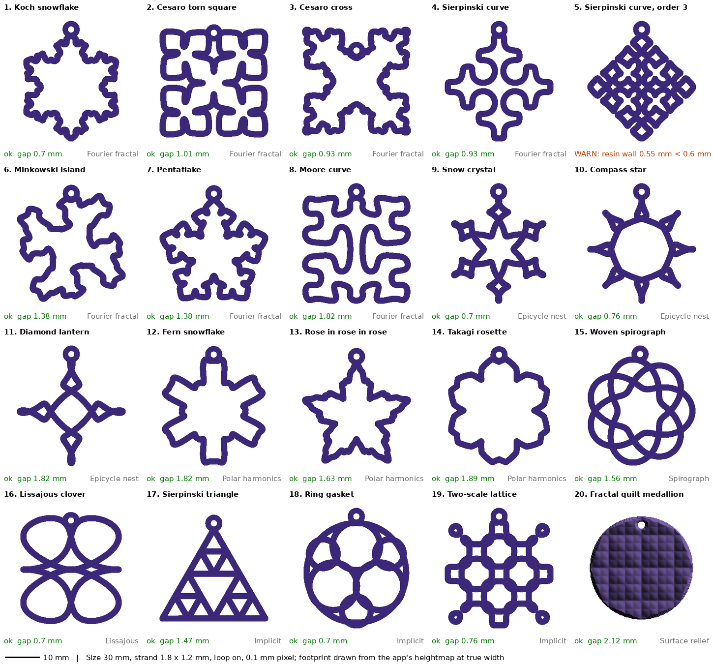
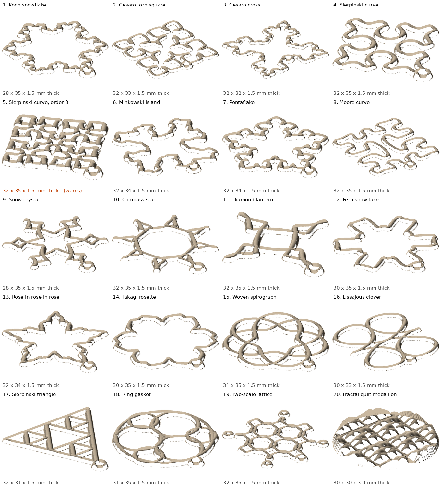

# Fractal earrings: 20 designs

Second batch for the equation playground: self-similar / fractal-looking shapes that still press as clay earrings.
Paste the equation into the app as is. Every constant is baked in, so there are no sliders to set.

## Settings used for the check

- Size 30 mm (all designs). Strand 1.8 x 1.2 mm, draft 20 deg, loop on (auto), pair mould, all other FormOptions / MouldOptions at their defaults.
- Pixel 0.1 mm (Draft build). Samples n = 800 (app default). Do not go below 800: the Fourier designs carry harmonics up to 85.
- Default ranges: t and theta 0 to 2 pi, implicit x, y -10 to 10, surface x, y -5 to 5.
- Each row was run through `core.parse` -> `core.sample` -> `geometry.build_all` (form + mould + lid) and the Check report read back.

Result: 19 of 20 clean (no warnings, form and mould watertight, 1 body, hang tilt 0 deg). 1 warns, marked below.

## Designs

| # | Name | Family | Equation | Size | Check |
|---|---|---|---|---|---|
| 1 | Koch snowflake | Fourier fractal (parametric) | `x = sin(t) - 0.09 sin(5 t) + 0.097 sin(7 t) + 0.035 sin(11 t) - 0.035 sin(17 t) - 0.011 sin(23 t) + 0.02 sin(25 t) + 0.019 sin(31 t) + 0.012 sin(47 t) - 0.013 sin(65 t), y = cos(t) + 0.09 cos(5 t) + 0.097 cos(7 t) - 0.035 cos(11 t) + 0.035 cos(17 t) + 0.011 cos(23 t) + 0.02 cos(25 t) + 0.019 cos(31 t) - 0.012 cos(47 t) + 0.013 cos(65 t)` | 30 mm | ok, min resin wall 0.7 mm, watertight |
| 2 | Cesaro torn square | Fourier fractal (parametric) | `x = cos(t) - 0.223 cos(3 t) - 0.251 cos(5 t) - 0.07 cos(7 t) - 0.099 cos(11 t) + 0.031 cos(13 t) + 0.066 cos(17 t) - 0.131 cos(21 t) - 0.026 cos(25 t) + 0.017 cos(27 t) - 0.018 cos(29 t) - 0.031 cos(43 t), y = -sin(t) - 0.223 sin(3 t) + 0.251 sin(5 t) - 0.07 sin(7 t) - 0.099 sin(11 t) - 0.031 sin(13 t) - 0.066 sin(17 t) + 0.131 sin(21 t) + 0.026 sin(25 t) + 0.017 sin(27 t) + 0.018 sin(29 t) - 0.031 sin(43 t)` | 30 mm | ok, min resin wall 1.01 mm, watertight |
| 3 | Cesaro cross | Fourier fractal (parametric) | `x = cos(t) - 0.219 cos(3 t) - 0.166 cos(5 t) - 0.044 cos(7 t) - 0.066 cos(11 t) + 0.012 cos(13 t) + 0.016 cos(15 t) + 0.034 cos(17 t) - 0.039 cos(21 t) - 0.013 cos(31 t) - 0.01 cos(35 t) - 0.016 cos(43 t) + 0.009 cos(65 t) - 0.012 cos(85 t), y = -sin(t) - 0.219 sin(3 t) + 0.166 sin(5 t) - 0.044 sin(7 t) - 0.066 sin(11 t) - 0.012 sin(13 t) + 0.016 sin(15 t) - 0.034 sin(17 t) + 0.039 sin(21 t) - 0.013 sin(31 t) - 0.01 sin(35 t) - 0.016 sin(43 t) - 0.009 sin(65 t) + 0.012 sin(85 t)` | 30 mm | ok, min resin wall 0.93 mm, watertight |
| 4 | Sierpinski curve | Fourier fractal (parametric) | `x = sin(t) - 0.226 sin(3 t) + 0.265 sin(5 t) + 0.094 sin(7 t) + 0.01 sin(9 t) - 0.133 sin(11 t) - 0.023 sin(13 t) + 0.032 sin(17 t) + 0.036 sin(21 t) + 0.016 sin(27 t) + 0.009 sin(31 t) + 0.009 sin(43 t), y = cos(t) + 0.226 cos(3 t) + 0.265 cos(5 t) - 0.094 cos(7 t) + 0.01 cos(9 t) + 0.133 cos(11 t) - 0.023 cos(13 t) + 0.032 cos(17 t) + 0.036 cos(21 t) - 0.016 cos(27 t) - 0.009 cos(31 t) - 0.009 cos(43 t)` | 30 mm | ok, min resin wall 0.93 mm, watertight |
| 5 | Sierpinski curve, order 3 | Fourier fractal (parametric) | `x = sin(t) - 0.225 sin(3 t) + 0.275 sin(5 t) + 0.095 sin(7 t) - 0.143 sin(11 t) - 0.029 sin(13 t) + 0.053 sin(17 t) + 0.107 sin(21 t) + 0.031 sin(27 t) + 0.025 sin(31 t) + 0.021 sin(39 t) - 0.067 sin(43 t), y = cos(t) + 0.225 cos(3 t) + 0.275 cos(5 t) - 0.095 cos(7 t) + 0.143 cos(11 t) - 0.029 cos(13 t) + 0.053 cos(17 t) + 0.107 cos(21 t) - 0.031 cos(27 t) - 0.025 cos(31 t) - 0.021 cos(39 t) + 0.067 cos(43 t)` | 30 mm | **WARN: resin wall 0.55 mm < 0.6 mm**, watertight |
| 6 | Minkowski island | Fourier fractal (parametric) | `x = .066cos(t)+.998sin(t)+.162cos(3t)-.029sin(3t)-.179cos(5t)+.098sin(5t)-.126cos(7t)-.034sin(7t)+.05cos(9t)+.002sin(9t)-.01cos(11t)+.027sin(11t)+.031cos(13t)+.044sin(13t)+.022cos(19t)-.011sin(19t)-.02cos(37t)-.014sin(37t)-.015cos(39t)+.018sin(39t), y = -.066sin(t)+.998cos(t)+.162sin(3t)+.029cos(3t)+.179sin(5t)+.098cos(5t)-.126sin(7t)+.034cos(7t)-.05sin(9t)+.002cos(9t)-.01sin(11t)-.027cos(11t)-.031sin(13t)+.044cos(13t)+.022sin(19t)+.011cos(19t)+.02sin(37t)-.014cos(37t)-.015sin(39t)-.018cos(39t)` | 30 mm | ok, min resin wall 1.38 mm, watertight |
| 7 | Pentaflake | Fourier fractal (parametric) | `x = sin(t) - 0.126 sin(4 t) + 0.161 sin(6 t) + 0.049 sin(9 t) - 0.054 sin(14 t) + 0.043 sin(21 t) + 0.061 sin(26 t) - 0.017 sin(31 t) - 0.014 sin(54 t), y = cos(t) + 0.126 cos(4 t) + 0.161 cos(6 t) - 0.049 cos(9 t) + 0.054 cos(14 t) + 0.043 cos(21 t) + 0.061 cos(26 t) - 0.017 cos(31 t) + 0.014 cos(54 t)` | 30 mm | ok, min resin wall 1.38 mm, watertight |
| 8 | Moore curve | Fourier fractal (parametric) | `x = .925cos(t)-.568cos(3t)-.159cos(5t)-.048cos(7t)-.078cos(9t)+.073cos(11t)+.085cos(13t)-.081cos(15t)-.058cos(17t)+.035cos(19t)+.013cos(23t)+.025cos(29t)-.02cos(31t)+.018cos(33t)-.017cos(35t), y = 1.075sin(t)-.085sin(3t)-.064sin(5t)+.184sin(7t)+.13sin(9t)+.041sin(11t)+.115sin(13t)-.047sin(15t)+.032sin(17t)-.035sin(19t)-.013sin(23t)-.025sin(29t)+.02sin(31t)+.018sin(33t)-.017sin(35t)` | 30 mm | ok, min resin wall 1.82 mm, watertight |
| 9 | Snow crystal | Epicycle nest (parametric) | `x = sin(t) - 0.45 sin(5 t) + 0.1 sin(19 t), y = cos(t) + 0.45 cos(5 t) + 0.1 cos(19 t)` | 30 mm | ok, min resin wall 0.7 mm, watertight |
| 10 | Compass star | Epicycle nest (parametric) | `x = cos(t) + 0.3 cos(7 t) + 0.08 cos(17 t), y = sin(t) - 0.3 sin(7 t) + 0.08 sin(17 t)` | 30 mm | ok, min resin wall 0.76 mm, watertight |
| 11 | Diamond lantern | Epicycle nest (parametric) | `x = cos(t) + 0.6 cos(3 t) + 0.15 cos(9 t), y = sin(t) - 0.6 sin(3 t) + 0.15 sin(9 t)` | 30 mm | ok, min resin wall 1.82 mm, watertight |
| 12 | Fern snowflake | Polar harmonics (polar) | `r = 1 - 0.3 cos(6 theta) + 0.1 cos(18 theta) - 0.03 cos(30 theta)` | 30 mm | ok, min resin wall 1.82 mm, watertight |
| 13 | Rose in rose in rose | Polar harmonics (polar) | `r = (1 + 0.3 sin(5 theta)) (1 - 0.1 sin(15 theta)) (1 + 0.03 sin(45 theta))` | 30 mm | ok, min resin wall 1.63 mm, watertight |
| 14 | Takagi rosette | Polar harmonics (polar) | `r = 1 + 0.12 (acos(cos(6 theta)) + acos(cos(12 theta))/2 + acos(cos(24 theta))/4)` | 30 mm | ok, min resin wall 1.89 mm, watertight |
| 15 | Woven spirograph | Spirograph (parametric) | `x = (1 + 0.4 cos(7 t)) cos(3 t), y = (1 + 0.4 cos(7 t)) sin(3 t)` | 30 mm | ok, min resin wall 1.56 mm, watertight |
| 16 | Lissajous clover | Lissajous (parametric) | `x = cos(3 t) + 0.25 cos(9 t), y = sin(2 t) - 0.35 sin(6 t)` | 30 mm | ok, min resin wall 0.7 mm, watertight |
| 17 | Sierpinski triangle | Implicit (implicit) | `max(-y-4.3, y/2+0.866x-4.3, y/2-0.866x-4.3)*max(y-2.15, -y/2+0.866x-2.15, -y/2-0.866x-2.15)*max((y-4.3)-1.075, -(y-4.3)/2+0.866x-1.075, -(y-4.3)/2-0.866x-1.075)*max((y+2.15)-1.075, -(y+2.15)/2+0.866(x-3.724)-1.075, -(y+2.15)/2-0.866(x-3.724)-1.075)*max((y+2.15)-1.075, -(y+2.15)/2+0.866(x+3.724)-1.075, -(y+2.15)/2-0.866(x+3.724)-1.075) = 0` | 30 mm | ok, min resin wall 1.47 mm, watertight |
| 18 | Ring gasket | Implicit (implicit) | `(x^2+y^2-81)*(x^2+(y-4.82)^2-18.5)*((x-4.175)^2+(y+2.41)^2-18.5)*((x+4.175)^2+(y+2.41)^2-18.5)*(x^2+(y+6.9)^2-6.76)*((x-5.975)^2+(y-3.45)^2-6.76)*((x+5.975)^2+(y-3.45)^2-6.76)*(x^2+y^2-0.09) = 0` | 30 mm | ok, min resin wall 0.7 mm, watertight |
| 19 | Two-scale lattice | Implicit (implicit) | `cos(x) cos(y) + 0.5 cos(2 x) cos(2 y) = 0.3 + (x^2 + y^2)^4/50000000` | 30 mm | ok, min resin wall 0.76 mm, watertight |
| 20 | Fractal quilt medallion | Surface relief (surface) | `z = abs(sin(x) sin(y)) + abs(sin(2 x) sin(2 y))/2 + abs(sin(4 x) sin(4 y))/4 + 0.0001 sqrt(24.5 - x^2 - y^2) + 0.0001 sqrt(x^2 + (y - 4.1)^2 - 0.12)` | 30 mm | ok, min resin wall 2.12 mm, watertight |

## Notes per design

1. **Koch snowflake**: level-3 Koch snowflake, first 10 harmonics (1, 5, 7, 11 ... 31). Form 27.9 x 35.1 x 1.5 mm, clay 0.233 cm3.
2. **Cesaro torn square**: Cesaro fractal (80 deg, level 2) on a square, 12 harmonics. Form 31.7 x 32.9 x 1.5 mm, clay 0.449 cm3.
3. **Cesaro cross**: Cesaro fractal (60 deg, level 3), 14 harmonics. Form 31.7 x 31.7 x 1.5 mm, clay 0.321 cm3.
4. **Sierpinski curve**: closed Sierpinski curve order 2, 12 harmonics. Form 31.7 x 35.1 x 1.5 mm, clay 0.264 cm3.
5. **Sierpinski curve, order 3**: closed Sierpinski curve order 3, 12 harmonics: too dense for 30 mm. Form 31.7 x 35.1 x 1.5 mm, clay 0.399 cm3.
6. **Minkowski island**: quadratic Koch (Minkowski sausage) island level 2, 10 harmonics, chiral. Form 31.7 x 34.1 x 1.5 mm, clay 0.275 cm3.
7. **Pentaflake**: inward 72 deg Cesaro on a pentagon, level 2, 9 harmonics. Form 31.7 x 33.8 x 1.5 mm, clay 0.283 cm3.
8. **Moore curve**: closed Hilbert (Moore) curve order 3, harmonics up to 35. Form 31.7 x 35.1 x 1.5 mm, clay 0.396 cm3.
9. **Snow crystal**: 3 epicycles, speeds 1, -5, 19. Form 27.8 x 35.1 x 1.5 mm, clay 0.253 cm3.
10. **Compass star**: 3 epicycles, speeds 1, -7, 17. Form 31.7 x 35.1 x 1.5 mm, clay 0.231 cm3.
11. **Diamond lantern**: 3 epicycles, speeds 1, -3, 9. Form 31.7 x 35.1 x 1.5 mm, clay 0.182 cm3.
12. **Fern snowflake**: 6-fold polar harmonics 6, 18, 30. Form 30.2 x 34.8 x 1.5 mm, clay 0.223 cm3.
13. **Rose in rose in rose**: 5-petal rose modulated by 15- and 45-petal roses. Form 31.7 x 33.7 x 1.5 mm, clay 0.21 cm3.
14. **Takagi rosette**: 3 terms of the Takagi (blancmange) series wrapped on a circle. Form 29.7 x 34.6 x 1.5 mm, clay 0.189 cm3.
15. **Woven spirograph**: 7 lobes over 3 turns. Form 31.3 x 34.9 x 1.5 mm, clay 0.366 cm3.
16. **Lissajous clover**: 3:2 Lissajous with third harmonics. Form 29.5 x 32.7 x 1.5 mm, clay 0.323 cm3.
17. **Sierpinski triangle**: level-2 Sierpinski triangle: product of 5 triangle outlines. Form 31.7 x 31.1 x 1.5 mm, clay 0.297 cm3.
18. **Ring gasket**: Apollonian-style circle packing, circles overlapped so tangent slivers close. Form 30.8 x 35.1 x 1.5 mm, clay 0.358 cm3.
19. **Two-scale lattice**: lattice at two scales, closed off by a radial term. Form 31.7 x 35.1 x 1.5 mm, clay 0.41 cm3.
20. **Fractal quilt medallion**: 3-octave relief on a disc; the sqrt terms cut the disc edge and a 2 mm hanging hole. Form 30.1 x 30.1 x 2.99 mm, clay 1.232 cm3.

## How the families work

- **Fourier fractal** (1 to 8): a real fractal polygon (Koch, Cesaro, Sierpinski curve, Minkowski, Moore) is walked at constant speed, Fourier transformed, and only the strongest harmonics are kept and written out by hand as `x = sum a cos(k t), y = sum b sin(k t)`. The number of harmonics is the detail knob: more harmonics = sharper fractal, but strands get closer than the mould allows. The counts here are the most that still pass at 30 mm.
- **Epicycle nest** (9 to 11): three stacked rotating circles with speeds like 1, -5, 19 and shrinking radii. Speeds that are equal modulo n give n-fold symmetry.
- **Polar harmonics** (12 to 14): `r = 1 + ...` with a harmonic, then 3x that harmonic at a third of the size, and so on (Weierstrass style). 14 uses triangle waves `acos(cos(k theta))`, the Takagi / blancmange series.
- **Spirograph** (15) and **Lissajous** (16): closed multi-turn curves; crossings are fine for the mould as long as the cells between strands stay open.
- **Implicit** (17 to 19): a product of outlines equal to 0 draws all outlines at once (17: five triangles via `max`, 18: eight circles). 19 is a lattice at two scales with a radial term that closes it off.
- **Surface relief** (20): three octaves of `abs(sin sin)` on a disc. The tiny `sqrt` terms are undefined outside the disc and inside a small circle, which cuts the round edge and a 2 mm hanging hole. The app does not add a loop to surface kinds, so the hole is the hanger. Relief is 3 mm, so it uses about 5x the clay of the strand designs.

## Caveats

- **5 (Sierpinski curve, order 3) cannot clear the check**: resin wall 0.55 mm < 0.6 mm at 30 mm (lens-shaped slivers where strands almost touch). Bigger sizes up to 40 mm do not fix it; the strand would have to be thinner. Kept as a showpiece; it builds watertight. Design 4 is the clean version of the same curve.
- 1, 9, 16, 18 pass with the smallest margin (min resin wall 0.7 mm). Do not shrink them below 30 mm without re-checking.
- 2, 3, 16: the auto loop lands in a dip of the top edge (it still joins the strand and hangs straight). Use Loop shift or Rotate in the app if you want it prouder.
- 6 (Minkowski island) is chiral; the pair mould gives a mirrored left and right, which suits it.
- 19 has four open strand ends with curls at the corners; they are part of the level set, not a glitch.
- Checked at the 0.1 mm draft pixel only. Run a print-quality Build before printing a mould.
